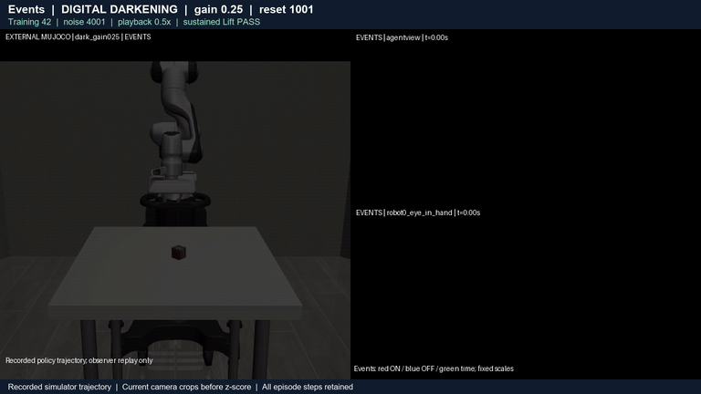
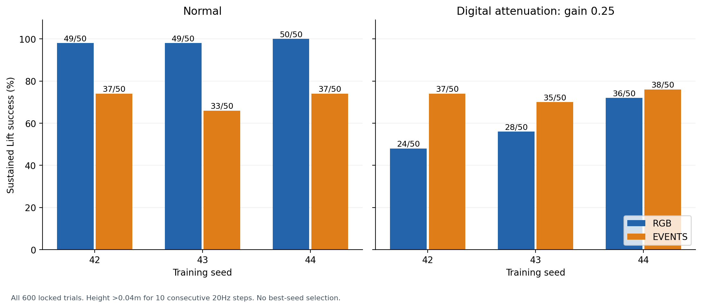
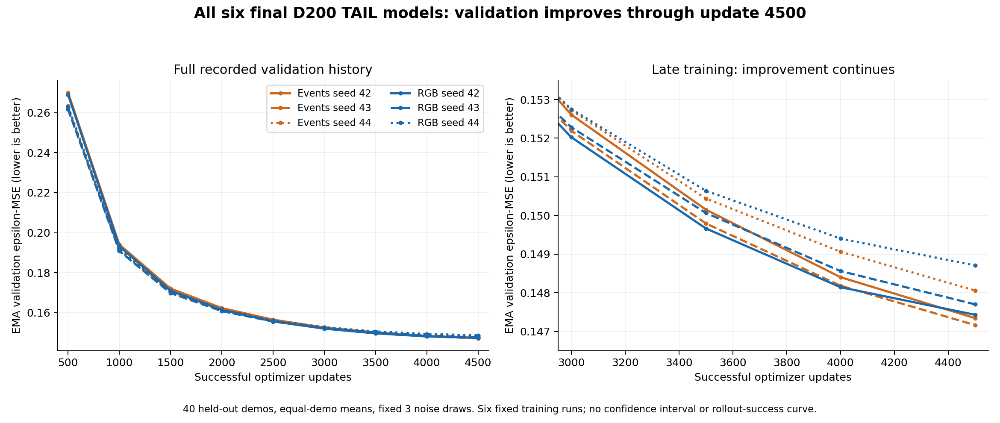
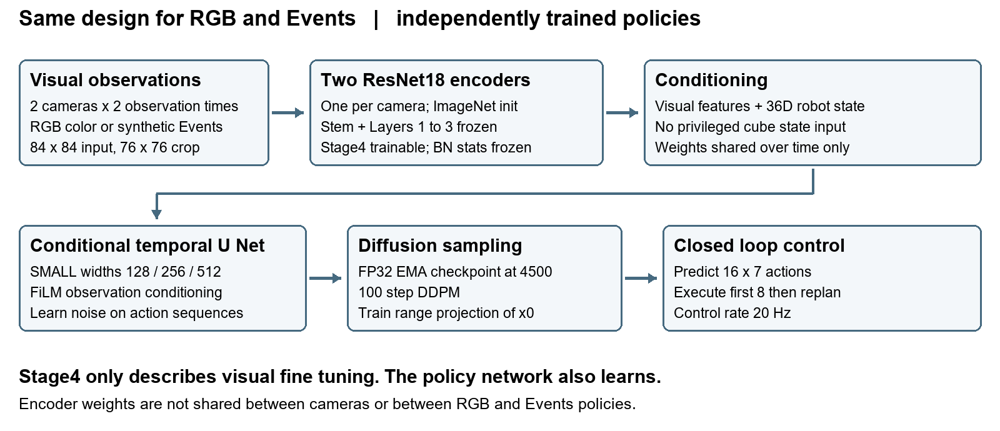

# Diffusion Policy RGB and Events

**Robot imitation learning with RGB and synthetic Events vision**  
Master's research project by **Adar Rubin** · [Personal GitHub](https://github.com/adarubin)


I built two vision-conditioned Diffusion Policies for robotic manipulation and studied how they behave when the visual input changes. The project covers demonstration processing, synthetic Events generation, paired model training, closed-loop simulation, evidence auditing and statistical reporting.

**Main finding:** RGB performs better in normal lighting. Under fixed digital darkening, the Events policy retains its performance and outperforms RGB. This is a controlled simulator result with synthetic noiseless Events, not a physical low-light camera benchmark.

[**Read the six-page progress report**](docs/Adar_Rubin_DiffusionPolicy_Progress_Report_2026-10-16.pdf) · [**Watch the complete 0.5x demonstration**](assets/DiffusionPolicy_RGB_Events_Examples_0p5x.mp4) · [**Inspect the results**](results/tables/groups.csv) · [**CPU analysis notebook**](notebooks/09_Final_Analysis_and_Report.ipynb)

## Watch the robot and its visual inputs

[](assets/DiffusionPolicy_RGB_Events_Examples_0p5x.mp4)

The animated preview is an excerpt. The linked **complete video** chains eight full episodes at **0.5x simulated-time playback**, including an RGB failure under darkening. Examples were fixed before outcomes: training seed 42, reset seeds 1000/1001 and noise seeds 4000/4001, both modalities and both lighting conditions.

- **Left half:** external simulator observer view of the recorded robot trajectory.
- **Right top:** fixed agentview camera input.
- **Right bottom:** wrist camera input.
- RGB panels show color; Events panels visualize the three Events channels. They are cached current center76 crops before normalization, enlarged into lossy MP4. The policy also uses the previous observation and robot state.

The video illustrates behavior; its eight clips do not estimate aggregate success. See [video provenance](assets/video_manifest.json).

## Results across the locked 600 episodes

| Condition | RGB sustained success | Events sustained success | Events minus RGB |
|---|---:|---:|---:|
| Normal | **148/150 · 98.67%** | 107/150 · 71.33% | -27.33 pp |
| Digital darkening gain 0.25 | 88/150 · 58.67% | **110/150 · 73.33%** | **+14.67 pp** |



RGB drops 40 percentage points under darkening; Events changes by +2 points. Dark Events advantages are 26, 14 and 4 points across training seeds 42,43 and44. The primary dark difference has a **conditional 95% paired shared-reset bootstrap interval of [+2.67,+26.67] pp**. Normal contrast: [-38.00,-17.33] pp. These intervals condition on six fixed models and 50 shared reset/noise pairs; they do not represent training-population or physical-sensor uncertainty. There are three trained models per modality, not 150.

**Metric:** cube height above the table exceeds 0.04 m for 10 consecutive 20 Hz control steps. Evaluation horizon: 300 steps. All 12 groups are reported; no final-seed tuning or successful-seed substitution.

## Training budget and learning curves



The final policies were compared under an equal **4500 optimizer-update budget**, equivalent to about **38.6 passes through the training windows**. An audit of all six archived training histories found that every model still achieved its best observed validation loss at the final update. The last 500 updates reduced validation epsilon-MSE by **0.465%–0.714%**. Improvement slowed, but these logs do **not** establish convergence or that further training would be useless. Validation loss is not a curve of robot success.

See the [training-budget review](docs/TRAINING_BUDGET_REVIEW.md), [six-run summary](results/training/training_budget_summary.csv) and [source audit](results/training/TRAINING_HISTORY_AUDIT.json). This read-only CPU audit adds no training, rollouts or GPU use. A small paired development study of additional training is a proposed next step; all original final models and results remain frozen.

To regenerate the figures from the included logs:

```bash
python scripts/plot_training_curves.py
```

## Architecture



Both policies use the same design, with independently trained weights:

| Component | Configuration |
|---|---|
| Visual encoder | Two ResNet18 encoders per policy, one per camera, initialized from ImageNet |
| Fine-tuning | Visual Stage4 trainable; earlier visual layers and BatchNorm running statistics frozen |
| Inputs | Two observation times; agentview and wrist cameras; 36D robot-only proprioception |
| Events | Positive polarity, negative polarity and time surface in 50 ms windows |
| Policy | SMALL conditional temporal U Net with FiLM, widths 128/256/512 |
| Action generation | 100-step FP32 DDPM; EMA checkpoint 4500; train-range x0 projection |
| Control | Predict 16 seven-dimensional actions; execute first 8 at 20 Hz, then replan (every 0.4 simulated seconds) |

Stage4-only applies to the visual encoders; the policy network also learns. Encoder weights are shared over time, but not across cameras or modalities. DINO was an initial alternative, not an evaluated baseline. Matching the encoder design controls a variable; it does not establish that either representation is optimally encoded.

## Engineering and research work

- Built the synchronized RGB/Events data pipeline from 200 demonstrations, with 160 training and 40 validation demonstrations.
- Reconstructed visual streams at 200 Hz from interpolated recorded states and generated synthetic Events with V2E. This is not recorded 200 Hz physics.
- Diagnosed incomplete late-demonstration coverage and implemented the TAIL export contract; retained the original development history and its limitations.
- Stabilized the paired training/inference contract, including frozen BatchNorm statistics, EMA handling and bounded action sampling.
- Evaluated three independent RGB/Events training pairs under matched reset/noise assignments.
- Independently rescored 600 episodes from 73,446 control rows and verified 9,204 core payloads, then reproduced the predeclared paired bootstrap and six figure sets.
- Published the analysis from Colab CPU without retraining or new simulation.

## Reproduce and inspect

### Inspect the included results without a GPU

```bash
python scripts/show_results.py
```

This reads the published summary tables; it does not claim to rerun the original simulations or repeat the step-level audit.

### Reproduce the full CPU analysis with the pinned evidence archive

```bash
pip install -r requirements-analysis.txt
python scripts/run_analysis.py --evidence /path/to/final_evaluation_core_evidence.zip --output analysis_outputs
```

The pinned core archive is an external research artifact and is not bundled in this public repository. Expected SHA256:

`e88a08e3552519567a90165d463737345ba9f04df1fcf1e15bbeb5914b8a8315`

Notebook09 is the canonical Colab CPU analysis/publication workflow. Training and simulation notebooks are research records requiring their documented Drive data/checkpoints and a compatible Colab runtime. **Do not Run all 00–09:** 00/01 are historical snapshots, 06 is a planned unexecuted sweep, 02–08 document completed stages, and 09 analyzes the completed evaluation. The public notebooks have outputs and account metadata removed, while cell sources remain unchanged; see [release provenance](RELEASE_PROVENANCE.json).

## Repository map

```text
notebooks/       Colab research notebooks 00 through 09
src/             Frozen evaluator reference modules
analysis/        Pinned CPU analysis engine
configs/         Actual frozen final evaluation protocol and freeze record
results/         Summary tables and six PNG/PDF figure pairs
assets/          Architecture, animated preview and full demonstration video
docs/            Supervisor progress report and editable report content
scripts/         Small CPU entry points for inspection and analysis
```

The original legacy D50 base YAML is intentionally not presented as the final D200 configuration. The final protocol in configs/ is the authoritative published evaluation contract. Datasets, checkpoint binaries, private conversation/context archives and credentials are not included.

## Progress and next questions

| Milestone from the initial supervisor conversation | Status |
|---|---|
| Sketch by 25 October 2026 | **✓ Exceeded in implementation scope:** working RGB/Events policies and final 600 |
| Working model and results by early December | **✓ Achieved for the present Lift setup** |
| Written report in mid December | Progress report available; final academic scope/format to confirm |
| Paper ready in early January and completion during January | Planned; exact requirements subject to supervisor review |

Next directions are **small feasibility screens**, not completed results: one additional robustness scenario and a slightly more complex manipulation task such as Can. Wider object/robot initialization distributions remain a reserve direction. New studies require separate untouched seeds, explicit sensor assumptions and a compute-budget gate. No positive outcome is promised, and negative screens will remain in the record.

## Scientific scope

Current evidence is limited to RoboMimic Lift, a fixed scene, the standard reset region, three training replications per modality and synthetic noiseless V2E under digitalgain 0.25. It does not establish physical Events-camera performance, a universal advantage for Events, or successful generalization to another task. Checkpoint identities are recorded; this public release is not a fresh audit of the original weight tensors or a complete Drive backup.

## References and acknowledgments

- [Diffusion Policy by Chi et al.](https://diffusion-policy.cs.columbia.edu/)
- [RoboMimic datasets and benchmark](https://robomimic.github.io/study/)
- [RoboSuite simulator](https://robosuite.ai/)
- [V2E by SensorsINI](https://github.com/SensorsINI/v2e)
- [Event-based Vision A Survey by Gallego et al.](https://arxiv.org/abs/1904.08405)

**Author:** Adar Rubin · [github.com/adarubin](https://github.com/adarubin)
