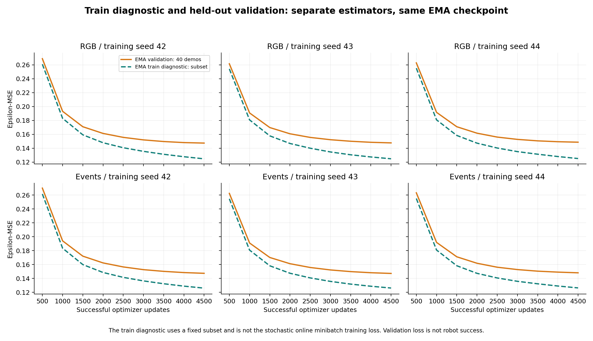

# Training budget adequacy review — 17 October 2026

Author: Adar Rubin. Read-only CPU analysis of existing archived training logs; no new training, model loading, rollout or Colab run.

## Finding

All six final D200 TAIL models have their best observed EMA validation epsilon-MSE at update 4500. Every recorded 500-update validation interval improves for every model. The final 500 updates reduce validation loss by **0.465% to 0.714%**, and the final 1000 by **1.282% to 1.870%**, relative to each interval's starting loss. Improvement slows, but the logs do **not** establish a plateau or that further training would be useless. They also do not establish how much more training would improve robot success.

## What the update count means

Each successful optimizer update accumulates 4 micro-batches of 16 windows, effective batch 64. The 4500 updates represent 18,000 successful micro-batches and 288,000 window exposures, or 38.606 equivalent passes through 7460 training windows from 160 demonstrations. Windows overlap and are not independent samples. A nominal epoch count alone does not certify adequate training. Each sequence window predicts 16 actions, not 16 independent examples or 16 optimizer updates. The 100 diffusion noise levels are another distinct concept.

## Evidence and metric

The six run identities/config hashes match the frozen model catalog. Four catalog-hashed archives provide the two seed 42 bundles and the two replication packages containing seeds 43/44. Outer and inner ZIP CRCs passed. Selected CSV/summary payloads were hashed and checked against each inner artifact manifest where listed. There are 54 validation records and 270 training-progress records; all six stops are budget_exhausted, early stopping disabled, schedule horizon 10000. Source weights, raw datasets and Drive checkpoint bytes were not re-audited.

Validation is EMA epsilon-MSE on 40 held-out demonstrations, equal-demo weighting, fixed 3 noise draws. The EMA train diagnostic uses a fixed subset, not the stochastic raw-model minibatch loss. Neither plot is a learning curve of robot success. No confidence intervals or statistical plateau criterion were added. The last logged points do not extrapolate beyond 4500.

| Modality | Training seed | Validation 3500 | Validation 4500 | Loss reduction, last 1000 | Loss reduction, last 500 |
|---|---:|---:|---:|---:|---:|
|events|42|0.150150|0.147343|1.870%|0.714%|
|events|43|0.149793|0.147164|1.755%|0.687%|
|events|44|0.150437|0.148058|1.581%|0.673%|
|rgb|42|0.149664|0.147430|1.493%|0.482%|
|rgb|43|0.150064|0.147700|1.575%|0.579%|
|rgb|44|0.150638|0.148707|1.282%|0.465%|

## Interpretation for the supervisor

The current 600-episode study is a completed comparison under an equal 4500-update budget, not a demonstration of optimally trained or converged policies. RGB normal sustained 148/150 is close to this test's ceiling but is not evidence that Events or robustness has saturated. Historical D50 early stopping and denoising degradation cannot establish a plateau for these D200 TAIL runs. More training can help, saturate or harm generalization; the current traces cannot determine which or prove that compute was insufficient.

## Proposed next gate, not executed

Review these existing curves first. Before expanding to another task, consider a small paired development study of training budget, rather than immediately committing to 100,000 updates (22.22 times 4500). Check the actual native Colab balance/rate before a costed GPU proposal. Use a new study/run identity, preserve all six original checkpoints/results, and if continuing use a verified full optimizer/EMA/LR/RNG/data-stream checkpoint with explicitly documented new budget. Weight-only milestones are not exact resumes.

A candidate design is one matched RGB/Events training pair, unchanged architecture/data and predeclared later checkpoints such as 7000 and 10000, retaining the original 10000-update LR schedule and checking its endpoint. Validate at fixed intervals and use separate untouched development reset/noise seeds for any robot-success comparison. Do not tune on or rerun the exposed final 1000–1049 test population. Define the stopping and promotion rule before seeing new results. One pair is a feasibility screen, not confirmation across training seeds. No GPU pilot or new simulations have been authorized/performed by this analysis.

## Primary-method reference

The original Diffusion Policy project publishes both training/evaluation logs and checkpoint-selection records. That supports inspecting learning behavior and robot performance explicitly; its epoch counts are not directly transferable to this implementation: [official code and experiment-log description](https://github.com/real-stanford/diffusion_policy#-checkout-our-experiment-logs).
